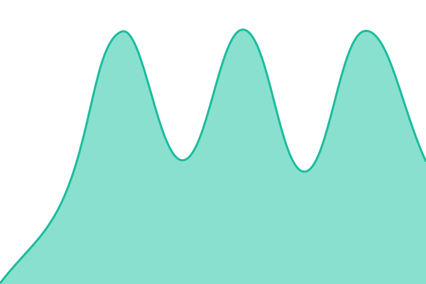
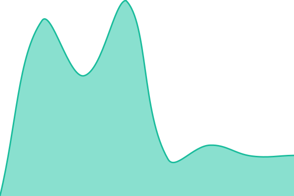
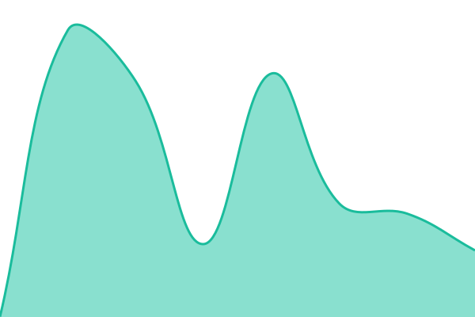
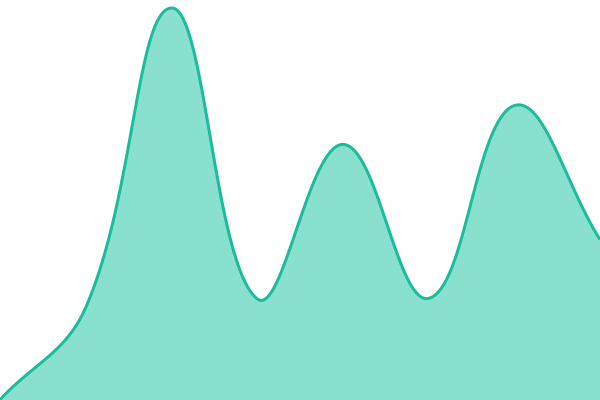
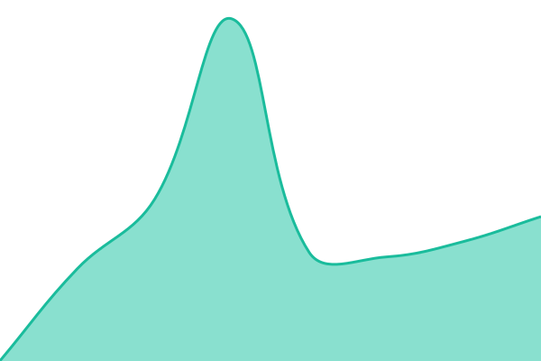
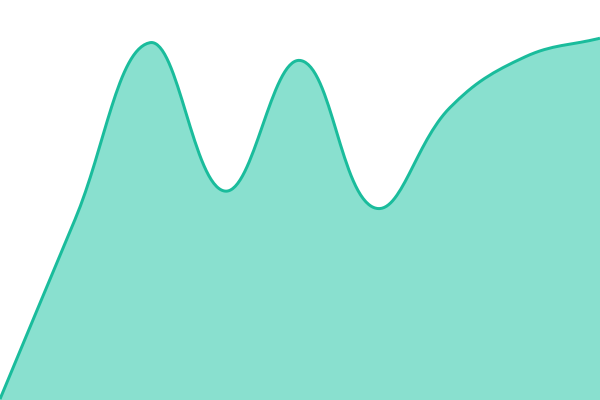

# [📈 Live Status](https://status.chubbyclub.com): <!--live status--> **🟩 All systems operational**

This repository contains the open-source uptime monitor and status page for [Chubby Club](https://chubbyclub.com), powered by [Upptime](https://github.com/upptime/upptime).

With [Upptime](https://upptime.js.org), you can get your own unlimited and free uptime monitor and status page, powered entirely by a GitHub repository. We use [Issues](https://github.com/Chubby-Club/status/issues) as incident reports, [Actions](https://github.com/Chubby-Club/status/actions) as uptime monitors, and [Pages](https://status.chubbyclub.com) for the status page.

<!--start: status pages-->
<!-- This summary is generated by Upptime (https://github.com/upptime/upptime) -->
<!-- Do not edit this manually, your changes will be overwritten -->
<!-- prettier-ignore -->
| URL | Status | History | Response Time | Uptime |
| --- | ------ | ------- | ------------- | ------ |
|  [Chubby Club](https://chubbyclub.com/) | 🟩 Up | [chubby-club.yml](https://github.com/Chubby-Club/status/commits/HEAD/history/chubby-club.yml) | 

 178ms
     
 | 

<a href="https://status.chubbyclub.com/history/chubby-club">100.00%</a>
    

|  [Join](https://join.chubbyclub.com/api/health) | 🟩 Up | [join.yml](https://github.com/Chubby-Club/status/commits/HEAD/history/join.yml) | 

 582ms
     
 | 

<a href="https://status.chubbyclub.com/history/join">100.00%</a>
    

|  [Plus](https://plus.chubbyclub.com/api/health) | 🟩 Up | [plus.yml](https://github.com/Chubby-Club/status/commits/HEAD/history/plus.yml) | 

 535ms
     
 | 

<a href="https://status.chubbyclub.com/history/plus">100.00%</a>
    

|  [Sign-in service](https://id.chubbyclub.com/.well-known/openid-configuration) | 🟩 Up | [sign-in-service.yml](https://github.com/Chubby-Club/status/commits/HEAD/history/sign-in-service.yml) | 

 250ms
     
 | 

<a href="https://status.chubbyclub.com/history/sign-in-service">100.00%</a>
    

|  [Member profile](https://my.chubbyclub.com/api/health) | 🟩 Up | [member-profile.yml](https://github.com/Chubby-Club/status/commits/HEAD/history/member-profile.yml) | 

 443ms
     
 | 

<a href="https://status.chubbyclub.com/history/member-profile">100.00%</a>
    

|  [Reservations](https://reserve.chubbyclub.com/api/health) | 🟩 Up | [reservations.yml](https://github.com/Chubby-Club/status/commits/HEAD/history/reservations.yml) | 

 235ms
     
 | 

<a href="https://status.chubbyclub.com/history/reservations">100.00%</a>
    

|  [Verification](https://verify.chubbyclub.com/api/health) | 🟩 Up | [verification.yml](https://github.com/Chubby-Club/status/commits/HEAD/history/verification.yml) | 

 470ms
     
 | 

<a href="https://status.chubbyclub.com/history/verification">100.00%</a>
    

|  [Promotions](https://promo.chubbyclub.com/api/health) | 🟩 Up | [promotions.yml](https://github.com/Chubby-Club/status/commits/HEAD/history/promotions.yml) | 

 542ms
     
 | 

<a href="https://status.chubbyclub.com/history/promotions">100.00%</a>
    

|  [Create](https://create.chubbyclub.com/api/health) | 🟩 Up | [create.yml](https://github.com/Chubby-Club/status/commits/HEAD/history/create.yml) | 

 412ms
     
 | 

<a href="https://status.chubbyclub.com/history/create">100.00%</a>
    

|  [Thank you](https://ty.chubbyclub.com/api/health) | 🟩 Up | [thank-you.yml](https://github.com/Chubby-Club/status/commits/HEAD/history/thank-you.yml) | 

 245ms
     
 | 

<a href="https://status.chubbyclub.com/history/thank-you">100.00%</a>
    

|  [Attend](https://attend.chubbyclub.com/api/health) | 🟩 Up | [attend.yml](https://github.com/Chubby-Club/status/commits/HEAD/history/attend.yml) | 

 542ms
     
 | 

<a href="https://status.chubbyclub.com/history/attend">100.00%</a>
    

|  [Partners](https://partner.chubbyclub.com/api/health) | 🟩 Up | [partners.yml](https://github.com/Chubby-Club/status/commits/HEAD/history/partners.yml) | 

 341ms
     
 | 

<a href="https://status.chubbyclub.com/history/partners">100.00%</a>
    

|  [Partner API](https://api.chubbyclub.com/) | 🟩 Up | [partner-api.yml](https://github.com/Chubby-Club/status/commits/HEAD/history/partner-api.yml) | 

 368ms
     
 | 

<a href="https://status.chubbyclub.com/history/partner-api">100.00%</a>
    

|  [Hub](https://a5.chubbyclub.com/api/health) | 🟩 Up | [hub.yml](https://github.com/Chubby-Club/status/commits/HEAD/history/hub.yml) | 

 577ms
     
 | 

<a href="https://status.chubbyclub.com/history/hub">100.00%</a>
    

|  [Legal](https://legal.chubbyclub.com/api/health) | 🟩 Up | [legal.yml](https://github.com/Chubby-Club/status/commits/HEAD/history/legal.yml) | 

 372ms
     
 | 

<a href="https://status.chubbyclub.com/history/legal">100.00%</a>
    

<!--end: status pages-->

[**Visit our status website →**](https://status.chubbyclub.com)

## 🛠️ Scheduled maintenance (staff)

An open issue labeled `maintenance` puts a maintenance window on the status page and pauses outage reports for the sites it names. Only Chubby Club staff can declare one:

1. Open an issue from the **Maintenance Event** template. Fill in `start`, `end` (ISO 8601, UTC) and `expectedDown` (site slugs, comma-separated) in the comment block.
2. Add the `maintenance` label. The template no longer adds it, and only people with triage access can add labels.
3. Close the issue when the work is done.

The [Maintenance guard](./.github/workflows/maintenance-guard.yml) workflow closes any issue that has the `maintenance` label but whose author is not an owner, org member or collaborator, and removes the label.

## 📄 License

- Powered by: [Upptime](https://github.com/upptime/upptime)
- Code: [MIT](./LICENSE) © [Anand Chowdhary](https://anandchowdhary.com)
- Data in the `./history` directory: [Open Database License](https://opendatacommons.org/licenses/odbl/1-0/)
